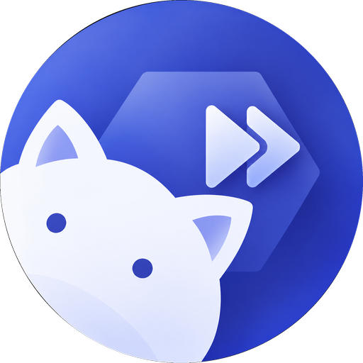
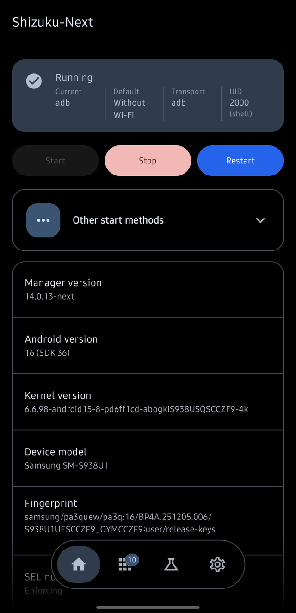
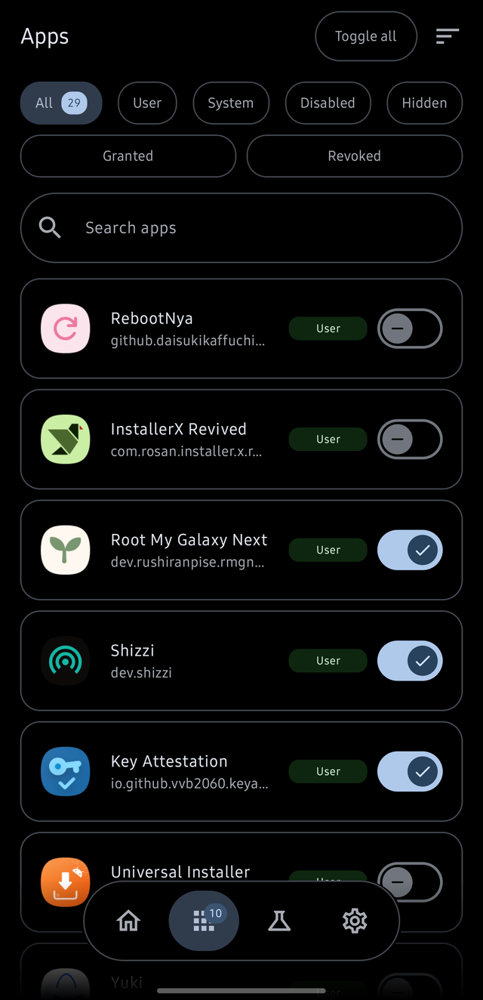
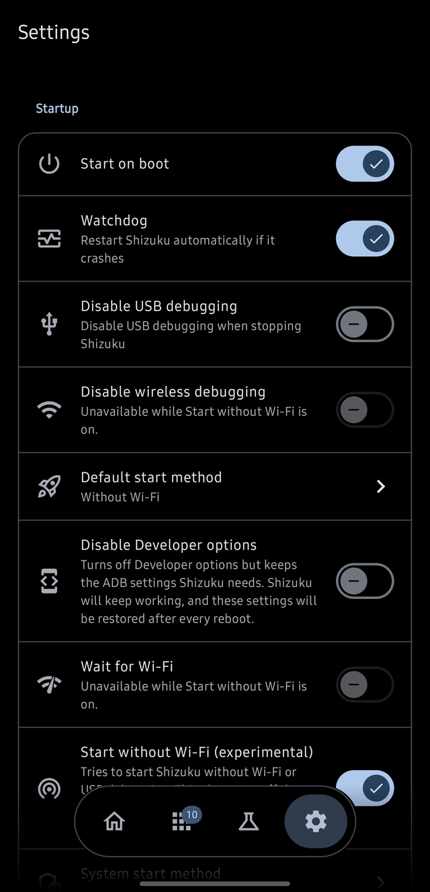

<div align="center">



# Shizuku Next TV

An enhanced fork of Shizuku for Android TV and Fire TV that lets apps use system APIs through ADB or root.

**[⬇ Download the latest release](https://github.com/depo23/Shizuku--Next-TV/releases/latest)** (`shizuku-next-tv.apk`)





[](https://github.com/depo23/Shizuku--Next-TV/stargazers)
[](https://github.com/depo23/Shizuku--Next-TV/releases)
[](https://github.com/depo23/Shizuku--Next-TV/releases/latest)
[](https://github.com/depo23/Shizuku--Next-TV/issues)
[](https://crowdin.com/project/Shizuku-Next)

</div>

## What's new in Shizuku Next TV

Changes made in this fork on top of [Shizuku-Next](https://github.com/rushiranpise/Shizuku-Next):

- **10-foot TV interface:** typography scaled 1.2x on television, a wider content area, and a two-pane Home with the status and actions beside the device pane, taller action buttons and two-row status facts.
- **Remote-friendly setup:** a D-pad-driven setup guide on Home while Shizuku is stopped, and dialog and sheet text fields that wait for OK before opening the keyboard.
- **Works on Fire TV and most Android TV:** TVs that only offer "ADB debugging" have no wireless pairing, so the default start on a television is now the ADB method over the network port. It finds the open port even when the platform does not name it.
- **Signed releases with a private key:** every build is signed with the project's own key, never the debug key, and published as a single `shizuku-next-tv.apk`.
- **In-app updates from this repository:** every push to `main` builds and publishes a release tagged `<version>.r<commit count>`, and the app updates from those releases.
- **Secret scanning:** a gitleaks workflow scans every push and pull request.

## About

Shizuku Next TV is a fork of [Shizuku-Next](https://github.com/rushiranpise/Shizuku-Next), which continues [thedjchi's Shizuku fork](https://github.com/thedjchi/Shizuku), based on the original [RikkaApps/Shizuku](https://github.com/RikkaApps/Shizuku).

It keeps Shizuku's package name and API, so compatible apps continue to work.

> **Important:** This fork uses a different signing key. Uninstall the official Shizuku, thedjchi's fork or Shizuku-Next before installing Shizuku Next TV. A server started by the previous app may remain active until stopped or the device is rebooted.

If you want the original app, visit [RikkaApps/Shizuku](https://github.com/RikkaApps/Shizuku).

## Download

Get `shizuku-next-tv.apk` from the [latest release](https://github.com/depo23/Shizuku--Next-TV/releases/latest). All builds are on the [Releases](https://github.com/depo23/Shizuku--Next-TV/releases) page.

## Features

### Starting and reliability
- Start through wireless debugging, USB debugging, root, or Samsung system UID where supported.
- Automatically handles wireless-debugging pairing, including reading the pairing code on supported devices.
- Optional start on boot, watchdog restarts, automatic recovery, and configurable restart timing.
- TCP mode, USB-port recovery, and experimental startup without Wi-Fi.
- Optional mode to hide Developer options and ADB settings.
- Clearer startup status, diagnostics, and failure logs.

### Manager tools
- Material 3 interface with Home, Apps, Modules, Labs, and Settings.
- Manage Shizuku access, app permissions, app ops, battery settings, and app network access, with a fallback to the platform's own firewall API on ROMs whose connectivity command is missing.
- Inspect app details and launch activities.
- Built-in shell, log viewer, file browser, and app installer.
- Manage saved Wi-Fi networks and export/import their credentials.
- Force dark mode and hide selected device settings for chosen apps.
- Batch permission changes, searchable app lists, and device information.
- Tasker and other automation support through intents and status broadcasts.

### Modules and compatibility
- Experimental ADB module support, including module actions, services, and WebUI. [Writing a module](docs/adb-modules.md) covers the format: `module.prop`, the environment a script runs in, the WebUI bridge, trust, and how a module gets found.
- Stealth mode and in-app updates.
- Android TV and VR-friendly UI support.
- MediaTek compatibility fixes and improvements for some devices.

Some features are experimental or device-dependent. Root, Samsung system-UID, and no-Wi-Fi startup methods are not available on every device. Only install modules and scripts you trust.

## Requirements

- **Android 7.0 or newer**
- **Wireless debugging:** Android 11 or newer; supported Android TVs are also compatible.
- **USB/PC start:** A computer with ADB.
- **Root start:** A rooted device with working root access.
- **System UID start:** Supported Samsung devices only.
- **Start on boot:** Supported start methods only.

See the [wiki](https://github.com/thedjchi/Shizuku/wiki) for setup and troubleshooting guidance.

## Privacy

- No tracking or analytics.
- No telemetry or proprietary libraries.
- No Google Play Services dependency.
- Open-source code and reproducible builds.
- Internet access is used for wireless-debugging connections, for checking and downloading GitHub
  updates, and for the module lists, which are read from GitHub.

The app requests permissions for features such as notifications, background services, wireless debugging, and boot startup. See the app's permission page and source code for details.

## Translations

Help translate Shizuku-Next on [Crowdin](https://crowdin.com/project/Shizuku-Next). See [`docs/translations.md`](docs/translations.md) for translation details.

## Support the project

Shizuku-Next is free and contains no ads. If you'd like to support development, you can [buy me a coffee](https://www.buymeacoffee.com/rushiranpise).

Please also consider supporting the upstream projects: [thedjchi](https://www.buymeacoffee.com/thedjchi) and [RikkaApps/Shizuku](https://github.com/RikkaApps/Shizuku).

## Developer guide

### API

The API documentation and demo project are available in the [Shizuku-API repository](https://github.com/thedjchi/Shizuku-API).

Shizuku may run with different privileges depending on the start method. Check the server UID and permissions before assuming root access. Prefer `ShizukuBinderWrapper` over calling `transactRemote` directly when possible.

### Build

```bash
git clone --recurse-submodules https://github.com/depo23/Shizuku--Next-TV.git
cd Shizuku--Next-TV
./gradlew :manager:assembleDebug
```

For a release build, run:

```bash
./gradlew :manager:assembleRelease
```

The debug task builds a debuggable server. In Android Studio, enable **Always install with package manager** in the Run/Debug configuration when debugging `shizuku_server`.

### Contributing

1. Fork the repository.
2. Create a feature branch.
3. Make and test your changes.
4. Commit and push your branch.
5. Open a pull request.

## Credits

- [RikkaW / RikkaApps](https://github.com/RikkaApps/Shizuku) - original Shizuku, server, and API.
- [thedjchi](https://github.com/thedjchi/Shizuku) - upstream fork and many inherited features.
- [kerneldroid](https://github.com/kerneldroid) - [Nightzuku](https://github.com/kerneldroid/Nightzuku), where the ADB modules feature comes from: the module format itself, actions and services, and the `window.Shizuku` WebUI bridge.
- [Shevery](https://github.com/HmnDev-Tech/shevery) - the published module API and guide this app's module support is written against, and the module catalogue it searches.
- [ShizuWall](https://github.com/AhmetCanArslan/ShizuWall) (AhmetCanArslan) - the firewall's fallback to the system API where a ROM has no connectivity command for it to use, and the technique behind it: the interface reached as Shizuku with a wrapped binder, by reflection.
- [Xhizuku](https://github.com/xeonleonreal/Xhizuku) - the other implementation of that format, whose documentation this one is checked against.
- [KernelSU-Next](https://github.com/KernelSU-Next/KernelSU-Next) - the card, chip and tab layout the modules list and the Material 3 interface follow.
- [MMRL](https://github.com/MMRLApp/MMRL) - the label component whose default accent colour the module cards' size chip follows.
- All upstream contributors and Crowdin translators.

## License

Licensed under [Apache License 2.0](LICENSE).

## Star History

<a href="https://www.star-history.com/?repos=depo23%2Fshizuku--next-tv&type=date&legend=top-left">
 <picture>
   <source media="(prefers-color-scheme: dark)" srcset="https://api.star-history.com/chart?repos=depo23/shizuku--next-tv&type=date&theme=dark&legend=top-left" />
   <source media="(prefers-color-scheme: light)" srcset="https://api.star-history.com/chart?repos=depo23/shizuku--next-tv&type=date&legend=top-left" />
   
 </picture>
</a>